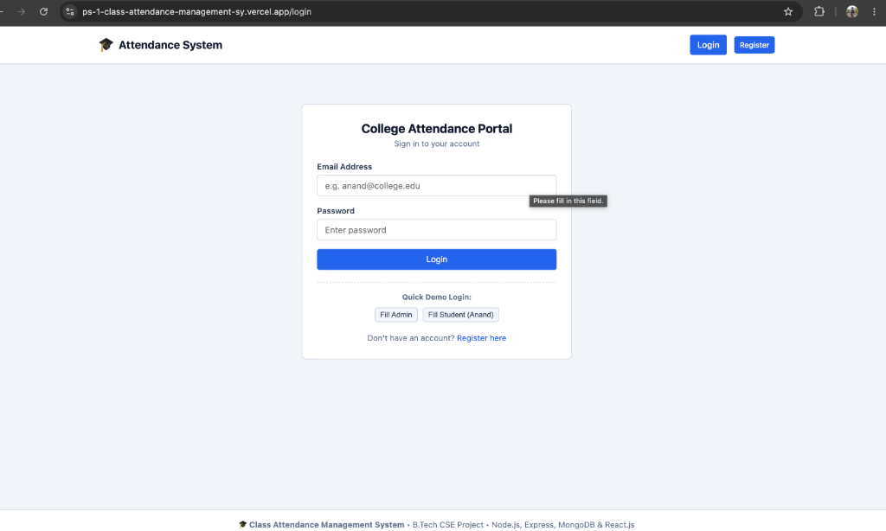
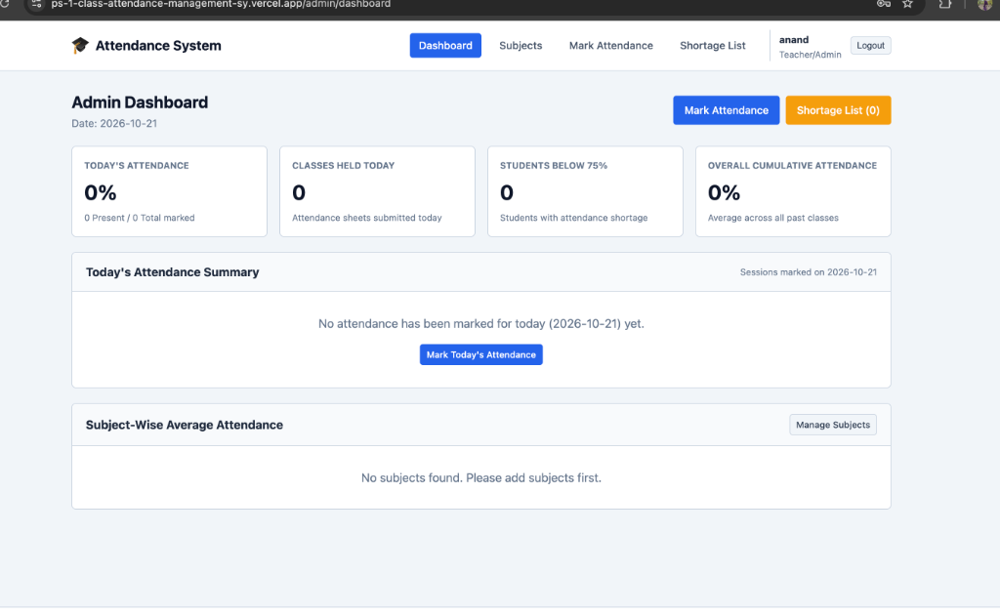
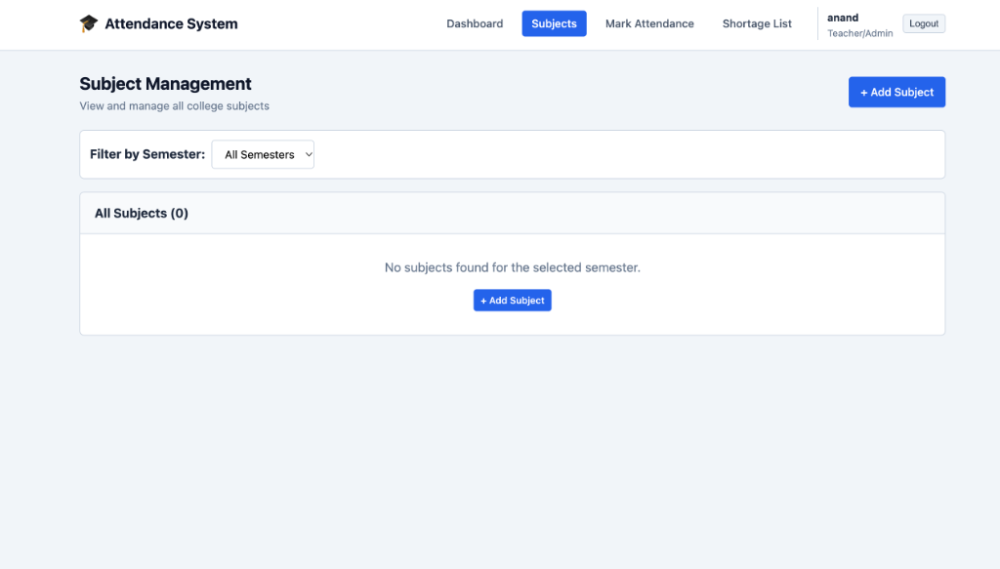

# 🎓 Class Attendance Management System

A beginner-friendly, full-stack **Class Attendance Management System** designed for college faculty and students. Built with **React.js (Vite)**, **Plain CSS**, **Node.js & Express.js**, and **MongoDB with Mongoose**.

This project provides end-to-end role-based authentication, subject management, duplicate-safe class session attendance logging, student portals, defaulter shortage reporting, live dashboard analytics, and the consecutive classes stretch-goal calculation formula.

## 🌐 Live Demo & Deployment Links

| Service | Platform | URL |
| :--- | :--- | :--- |
| **Frontend Application** | Vercel | [https://ps-1-class-attendance-management-sy.vercel.app](https://ps-1-class-attendance-management-sy.vercel.app/) |
| **Backend API Service** | Render | [https://ps1-class-attendance-management-system-1.onrender.com](https://ps1-class-attendance-management-system-1.onrender.com) |
| **API Health Endpoint** | Render | [https://ps1-class-attendance-management-system-1.onrender.com/api/health](https://ps1-class-attendance-management-system-1.onrender.com/api/health) |

---

## 📸 Screenshots

| 1. User Login | 2. Admin Dashboard |
| :---: | :---: |
|  |  |

| 3. Subject Management |
| :---: |
|  |

---

## 📑 Table of Contents

- [Live Demo & Deployment Links](#-live-demo--deployment-links)
- [Screenshots](#-screenshots)
- [Key Features](#-key-features)
- [System Architecture](#-system-architecture)
- [Folder Structure](#-folder-structure)
- [Prerequisites](#-prerequisites)
- [Environment Variables](#-environment-variables)
- [Installation & Quick Start](#-installation--quick-start)
- [Initial Admin & Demo Credentials](#-initial-admin--demo-credentials)
- [Stretch Goal: Consecutive Classes Formula](#-stretch-goal-consecutive-classes-formula)
- [Running Automated Tests](#-running-automated-tests)
- [Requirements-to-File Implementation Checklist](#-requirements-to-file-implementation-checklist)

---

## 🌟 Key Features

1. **Authentication & Role Authorization**:
   - Separate portals for **Students** and **Teachers / Admins**.
   - Password encryption using **bcryptjs**.
   - Secure stateless session management using **JSON Web Tokens (JWT)**.
   - Admin registration security key (`ADMIN_SECRET_KEY`) prevents unauthorized users from claiming faculty privileges.

2. **Admin Subject Management**:
   - Complete CRUD operations: View, Create, Edit, and Delete subjects.
   - Fields: Subject Name, Subject Code, Semester (1–8), Teacher Name.
   - Database validation preventing duplicate subject codes.

3. **Attendance Marking with Duplicate Prevention**:
   - Filter students by semester automatically upon selecting a subject.
   - Select attendance date (defaults to current date).
   - Fast toggle switches for **Present** and **Absent** with live percentage counter.
   - Bulk action helpers: *"Mark All Present"* and *"Mark All Absent"*.
   - **Duplicate Attendance Prevention**: Automatically detects if an attendance sheet already exists for the subject and date. If found, opens the sheet in **Edit Mode**, preloads saved statuses, and performs an update rather than creating duplicates.
   - MongoDB compound unique index `{ subject: 1, date: 1 }` prevents race conditions.

4. **Student Attendance Portal**:
   - Student dashboard showing all enrolled subjects for their semester.
   - Live metrics: Total classes conducted, classes attended, missed classes, attendance percentage.
   - Date-wise session history modal/page with status badges.
   - Strict privacy: Students can only view their own attendance records.

5. **Defaulter Shortage List (< 75%)**:
   - Flags all students below the mandatory 75% college attendance threshold in any subject.
   - Visual red badges highlighting defaulters.
   - Integrated stretch goal calculation displaying how many consecutive classes are needed to clear the shortage.

6. **Faculty Admin Dashboard**:
   - Real-time attendance rate for today's date.
   - Today's class session summary table.
   - Total students below 75% threshold.
   - Cumulative overall attendance across the entire institution.
   - Subject-wise average attendance breakdown with visual benchmark progress bars.

7. **Stretch Goal: Consecutive Classes to Reach 75%**:
   - Solves `(attended + x) / (total + x) >= 0.75` for the smallest non-negative integer `x`.
   - Displays clear advice: *"Attend next X consecutive classes to reach 75%"* or *"No additional classes needed"*.

---

## 🏛 System Architecture

```
┌─────────────────────────────────────────────────────────────┐
│                   React.js Frontend (Vite)                  │
│   • React Router DOM (v7)      • Plain CSS Design System    │
│   • AuthContext State          • Fetch API Client           │
└──────────────────────────────┬──────────────────────────────┘
                               │ HTTP /api JSON (JWT Bearer)
                               ▼
┌─────────────────────────────────────────────────────────────┐
│                 Node.js / Express.js Backend                │
│   • Auth Router                • Subjects Router            │
│   • Attendance Router          • Dashboard & Shortage Router│
│   • JWT Middleware (protect)   • Role Authorization         │
└──────────────────────────────┬──────────────────────────────┘
                               │ Mongoose ODM
                               ▼
┌─────────────────────────────────────────────────────────────┐
│                     MongoDB Database                        │
│   • Users (role, roll, sem)    • Subjects (code, sem)       │
│   • Attendance Sheets (compound index: subject + date)      │
└─────────────────────────────────────────────────────────────┘
```

---

## 📂 Folder Structure

```
Student-project/
├── backend/
│   ├── config/
│   │   └── db.js                  # MongoDB Mongoose connection
│   ├── middleware/
│   │   └── auth.js                # JWT verification & role authorization
│   ├── models/
│   │   ├── Attendance.js          # Attendance sheet schema with unique index
│   │   ├── Subject.js             # Academic subject schema
│   │   └── User.js                # User schema with bcrypt pre-save hook
│   ├── routes/
│   │   ├── attendance.js          # Attendance marking & duplicate checks
│   │   ├── auth.js                # Login, register, profile
│   │   ├── dashboard.js           # Admin KPI stats & shortage list
│   │   ├── student.js             # Student-only attendance records
│   │   └── subjects.js            # Subject CRUD endpoints
│   ├── utils/
│   │   └── attendanceCalculator.js # Math formula for 75% stretch goal
│   ├── .env                       # Backend environment configuration
│   ├── package.json               # Backend dependencies and scripts
│   ├── seed.js                    # Database seeder for demo presentation
│   ├── server.js                  # Express application entry point
│   └── test-suite.js              # Automated integration tests
├── frontend/
│   ├── public/
│   ├── src/
│   │   ├── components/
│   │   │   ├── AttendanceBadge.jsx # Visual status and percentage badges
│   │   │   ├── Navbar.jsx         # Responsive role-aware header navigation
│   │   │   ├── ProtectedRoute.jsx # Client-side route security
│   │   │   └── StatCard.jsx       # Reusable dashboard metric card
│   │   ├── context/
│   │   │   └── AuthContext.jsx    # React Context for user authentication
│   │   ├── pages/
│   │   │   ├── AdminDashboard.jsx # /admin/dashboard
│   │   │   ├── Login.jsx          # /login
│   │   │   ├── MarkAttendance.jsx # /admin/attendance/mark
│   │   │   ├── Register.jsx       # /register
│   │   │   ├── ShortageList.jsx   # /admin/shortage
│   │   │   ├── StudentAttendance.jsx # /my-attendance
│   │   │   ├── SubjectAttendanceDetails.jsx # /my-attendance/:subjectId
│   │   │   ├── SubjectForm.jsx    # /admin/subjects/new & :id/edit
│   │   │   └── SubjectList.jsx    # /admin/subjects
│   │   ├── utils/
│   │   │   └── api.js             # Fetch wrapper with Authorization header
│   │   ├── App.jsx                # Router and view definitions
│   │   ├── index.css              # Plain CSS design system
│   │   └── main.jsx               # React DOM entry point
│   ├── index.html
│   ├── package.json
│   └── vite.config.js             # Vite config with backend proxy
├── package.json                   # Root package script runner
└── README.md
```

---

## ⚙️ Environment Variables

The backend uses a `.env` file located in `backend/.env`:

```env
PORT=5000
MONGODB_URI=mongodb://127.0.0.1:27017/class_attendance_db
JWT_SECRET=super_secret_jwt_key_attendance_system_2026
ADMIN_SECRET_KEY=admin123
```

- `PORT`: Port for the Express REST server (default `5000`).
- `MONGODB_URI`: Connection string for MongoDB.
- `JWT_SECRET`: Cryptographic secret used to sign and verify JSON Web Tokens.
- `ADMIN_SECRET_KEY`: Passcode required during registration to obtain an Admin/Teacher account.

---

## 🚀 Installation & Quick Start

### 1. Start MongoDB
Ensure MongoDB is running locally on port `27017`:
```bash
mongod --config /opt/homebrew/etc/mongod.conf
```

### 2. Backend Setup
In a new terminal window:
```bash
cd backend
npm install
npm run seed      # Seeds admin, students, subjects & historical attendance
npm start         # Starts backend at http://localhost:5000
```

### 3. Frontend Setup
In a second terminal window:
```bash
cd frontend
npm install
npm run dev       # Starts Vite dev server at http://localhost:5173
```

Open your browser and navigate to: **`http://localhost:5173`**

---

## 🔑 Initial Admin & Demo Credentials

Use the pre-seeded accounts or click the **"Quick Demo Logins"** buttons on the Login page:

| Role | Email | Password | Details |
| :--- | :--- | :--- | :--- |
| **Faculty / Admin** | `admin@college.edu` | `Admin@123` | Dr. Suresh Kumar (HOD) |
| **Student (Shortage)** | `anand@college.edu` | `Student@123` | Anand Yadav (Roll: `23CS001`, Sem 4-A) |
| **Student (Safe)** | `diya@college.edu` | `Student@123` | Diya Patel (Roll: `23CS002`, Sem 4-A) |
| **Student (Shortage)** | `rohan@college.edu` | `Student@123` | Rohan Gupta (Roll: `23CS003`, Sem 4-A) |

### Creating a New Admin Account via Public Registration:
1. Navigate to `/register`.
2. Click the **"👨‍🏫 Teacher / Admin"** tab.
3. Enter Name, Email, Password, and the Admin Secret Key (`admin123`).
4. Click **Complete Registration**.

---

## 📐 Stretch Goal: Consecutive Classes Formula

To find how many consecutive upcoming classes $x$ a student must attend to bring their attendance percentage up to at least $75\%$:

$$\frac{\text{attended} + x}{\text{total} + x} \ge 0.75$$

Multiply both sides by $(\text{total} + x)$:

$$\text{attended} + x \ge 0.75 \cdot (\text{total} + x)$$

$$\text{attended} + x \ge 0.75 \cdot \text{total} + 0.75 \cdot x$$

$$0.25 \cdot x \ge 0.75 \cdot \text{total} - \text{attended}$$

Multiply by 4:

$$x \ge 3 \cdot \text{total} - 4 \cdot \text{attended}$$

Therefore, the smallest non-negative integer $x$ is:

$$x = \max(0, \lceil 3 \cdot \text{total} - 4 \cdot \text{attended} \rceil)$$

### Example Verification:
- **Case 1 (Prompt Example)**: Attended $6$, Total $10$ ($60\%$ attendance):
  $$x = 3(10) - 4(6) = 30 - 24 = 6$$
  *Verification*: $\frac{6 + 6}{10 + 6} = \frac{12}{16} = 0.75$ ($75.0\%$). Needs exactly $6$ consecutive classes.
- **Case 2**: Attended $7$, Total $10$ ($70\%$ attendance):
  $$x = 3(10) - 4(7) = 30 - 28 = 2$$
  *Verification*: $\frac{7 + 2}{10 + 2} = \frac{9}{12} = 0.75$ ($75.0\%$). Needs $2$ consecutive classes.
- **Case 3**: Attended $8$, Total $10$ ($80\%$ attendance):
  Already $\ge 75\%$, so $x = 0$.

---

## 🧪 Running Automated Tests

Run the 24-point automated integration test suite against the running API:

```bash
node backend/test-suite.js
```

---

## ✅ Requirements-to-File Implementation Checklist

| # | Requirement Specification | Implementation File(s) | Status |
| :-: | :--- | :--- | :-: |
| **1** | **Tech Stack**: React (Vite), React Router DOM, Plain CSS, Node.js, Express, MongoDB, Mongoose, bcryptjs, JWT | [`backend/package.json`](file:///Users/anandyadav/Desktop/Student-project/backend/package.json), [`frontend/package.json`](file:///Users/anandyadav/Desktop/Student-project/frontend/package.json), [`backend/server.js`](file:///Users/anandyadav/Desktop/Student-project/backend/server.js) | ✅ Verified |
| **2** | **Authentication & Roles**: `/login`, `/register`, Student & Teacher roles, student fields (Roll, Sem, Sec), Admin authorization secret key, password hashing, protected routes | [`backend/models/User.js`](file:///Users/anandyadav/Desktop/Student-project/backend/models/User.js), [`backend/routes/auth.js`](file:///Users/anandyadav/Desktop/Student-project/backend/routes/auth.js), [`frontend/src/pages/Login.jsx`](file:///Users/anandyadav/Desktop/Student-project/frontend/src/pages/Login.jsx), [`frontend/src/pages/Register.jsx`](file:///Users/anandyadav/Desktop/Student-project/frontend/src/pages/Register.jsx) | ✅ Verified |
| **3** | **Admin Subject Management**: `/admin/subjects`, `/admin/subjects/new`, `/admin/subjects/:id/edit`, Add, Edit, Delete subjects, duplicate code prevention | [`backend/models/Subject.js`](file:///Users/anandyadav/Desktop/Student-project/backend/models/Subject.js), [`backend/routes/subjects.js`](file:///Users/anandyadav/Desktop/Student-project/backend/routes/subjects.js), [`frontend/src/pages/SubjectList.jsx`](file:///Users/anandyadav/Desktop/Student-project/frontend/src/pages/SubjectList.jsx), [`frontend/src/pages/SubjectForm.jsx`](file:///Users/anandyadav/Desktop/Student-project/frontend/src/pages/SubjectForm.jsx) | ✅ Verified |
| **4** | **Mark Attendance**: `/admin/attendance/mark`, Subject & Date pickers, loads semester students, Present/Absent toggles, Duplicate Sheet detection & Edit Mode, DB unique index | [`backend/models/Attendance.js`](file:///Users/anandyadav/Desktop/Student-project/backend/models/Attendance.js), [`backend/routes/attendance.js`](file:///Users/anandyadav/Desktop/Student-project/backend/routes/attendance.js), [`frontend/src/pages/MarkAttendance.jsx`](file:///Users/anandyadav/Desktop/Student-project/frontend/src/pages/MarkAttendance.jsx) | ✅ Verified |
| **5** | **Student Attendance**: `/my-attendance`, `/my-attendance/:subjectId`, enrolled subjects summary, date-wise history with Present/Absent status, student-only privacy | [`backend/routes/student.js`](file:///Users/anandyadav/Desktop/Student-project/backend/routes/student.js), [`frontend/src/pages/StudentAttendance.jsx`](file:///Users/anandyadav/Desktop/Student-project/frontend/src/pages/StudentAttendance.jsx), [`frontend/src/pages/SubjectAttendanceDetails.jsx`](file:///Users/anandyadav/Desktop/Student-project/frontend/src/pages/SubjectAttendanceDetails.jsx) | ✅ Verified |
| **6** | **Shortage List**: `/admin/shortage`, displays students below 75% in any subject, red percentage highlight, multi-subject occurrences | [`backend/routes/dashboard.js`](file:///Users/anandyadav/Desktop/Student-project/backend/routes/dashboard.js), [`frontend/src/pages/ShortageList.jsx`](file:///Users/anandyadav/Desktop/Student-project/frontend/src/pages/ShortageList.jsx) | ✅ Verified |
| **7** | **Dashboard**: `/admin/dashboard`, today's overall %, subject-wise average %, total students below 75%, today's session summary, calculated from actual DB | [`backend/routes/dashboard.js`](file:///Users/anandyadav/Desktop/Student-project/backend/routes/dashboard.js), [`frontend/src/pages/AdminDashboard.jsx`](file:///Users/anandyadav/Desktop/Student-project/frontend/src/pages/AdminDashboard.jsx) | ✅ Verified |
| **8** | **Stretch Goal**: Formula $(attended + x) / (total + x) \ge 0.75$, smallest non-negative integer $x$, displays advice on student dashboard & shortage list | [`backend/utils/attendanceCalculator.js`](file:///Users/anandyadav/Desktop/Student-project/backend/utils/attendanceCalculator.js), [`frontend/src/utils/api.js`](file:///Users/anandyadav/Desktop/Student-project/frontend/src/utils/api.js), [`frontend/src/pages/StudentAttendance.jsx`](file:///Users/anandyadav/Desktop/Student-project/frontend/src/pages/StudentAttendance.jsx), [`frontend/src/pages/ShortageList.jsx`](file:///Users/anandyadav/Desktop/Student-project/frontend/src/pages/ShortageList.jsx) | ✅ Verified |
| **9** | **Beginner-Friendly Code**: Functional React, `useState`, `useEffect`, clean Fetch API, plain CSS, clear comments for viva presentation | Throughout all files in `frontend/src/` and `backend/` | ✅ Verified |
| **10**| **UI & Styling**: Clean college project interface, Navbar, cards, tables, toggles, loading/empty states, responsive design | [`frontend/src/index.css`](file:///Users/anandyadav/Desktop/Student-project/frontend/src/index.css), [`frontend/src/components/Navbar.jsx`](file:///Users/anandyadav/Desktop/Student-project/frontend/src/components/Navbar.jsx), [`frontend/src/components/StatCard.jsx`](file:///Users/anandyadav/Desktop/Student-project/frontend/src/components/StatCard.jsx) | ✅ Verified |
| **11**| **Database Integrity**: Normalized `YYYY-MM-DD` dates, compound unique index on `{ subject, date }` | [`backend/models/Attendance.js`](file:///Users/anandyadav/Desktop/Student-project/backend/models/Attendance.js) | ✅ Verified |
